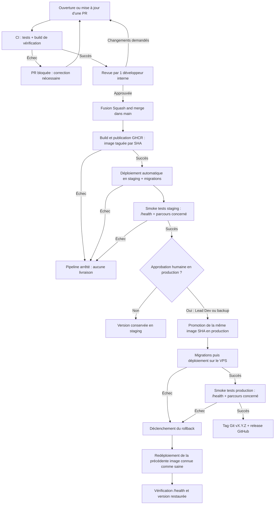

# Pipeline CI/CD

Ce document décrit le pipeline retenu pour l'équipe : **3 développeurs internes (dont la Lead Dev) + 1 développeur freelance à mi-temps**.

Il applique GitHub Flow et les règles de `CONTRIBUTING.md`. Il répond notamment aux risques R1 (push direct), R2 (déploiement sans tests et tag `latest`), R3 (secrets), R4 (migrations manuelles), R5 (version inconnue et absence de rollback), R6 (déploiement sans approbation), R7 (relecteur absent) et R8 (droits du freelance).

> Le workflow GitHub Actions de CI du T5 exécute les tests Python et vérifie la construction de l'image Docker sur les PR vers `main` et les push sur `main`. Le déploiement décrit ci-dessous sera ajouté en partie 2.

## 1. Principes retenus

- **Une PR est obligatoire vers `main`**. La CI exécute les tests et vérifie que l'image Docker peut être construite. Une approbation d'un développeur interne est également obligatoire avant le merge (R1, R7, R8).
- **`main` déclenche le déploiement en staging**, jamais directement en production. L'image est publiée dans GHCR avec un identifiant immuable basé sur le commit, par exemple `sha-a1b2c3d`. Le tag `latest` n'est jamais utilisé (R2, R5).
- **La même image est promue de staging vers production** après le smoke test et l'approbation humaine. On ne reconstruit pas une nouvelle image pour la production : on évite ainsi qu'un build différent soit déployé après validation (R2, R5, R6).
- **La production exige l'approbation de la Lead Dev ou de son backup** via l'environnement GitHub `production`. Un seul des deux suffit ; le backup intervient si la Lead Dev est absente (R6, R7).
- **Les migrations sont exécutées par le déploiement**, et non à la main sur le serveur. Elles doivent être versionnées, idempotentes et compatibles avec la version précédente de l'API. Une erreur de migration arrête le déploiement (R4, R5).
- Les secrets de déploiement restent dans les secrets GitHub de l'environnement concerné et sur le VPS. Ils ne sont ni copiés dans le dépôt ni intégrés à l'image. Le freelance n'a pas accès aux secrets de production (R3, R8).
- Un seul déploiement de production peut être exécuté à la fois. Cela évite que deux mises en production ou un rollback se chevauchent (R5, R6).
- Le workflow `Rollback` contrôle l’identité de la personne qui le déclenche : seuls la Lead Dev et le backup sont autorisés à lancer une restauration. C’est nécessaire car le freelance possède le droit GitHub `Write` et peut, par défaut, déclencher un workflow manuel (R8).

## 2. Schéma du pipeline

### Points d'approbation humaine

1. **Avant le merge :** un développeur interne autre que l'auteur approuve la PR. Le freelance peut ouvrir une PR et répondre aux commentaires, mais son approbation ne remplace pas celle d'un interne (R1, R7, R8).
2. **Avant la production :** la Lead Dev ou le backup approuve le déploiement de l'environnement GitHub `production`, après le déploiement et le smoke test en staging (R6).
3. **En cas d'urgence :** la Lead Dev ou le backup déclenche le workflow de rollback décrit en §4. Le rollback ne nécessite pas de reconstruire l'image.

## 3. Étapes, déclencheurs et durées estimées

Les durées sont des objectifs indicatifs pour une petite API et une image Docker légère. Le temps d'attente d'une personne n'est pas inclus dans les durées d'exécution des jobs.

| Étape | Déclencheur | Durée estimée | Bloquante ? | Résultat / règle |
|---|---|---:|---|---|
| 1. CI de PR | Ouverture, réouverture ou nouveau push sur une PR vers `main` | 2 à 4 min | **Oui** | Lance les tests et vérifie le build Docker. En cas d'échec, le merge est interdit (R1, R2). |
| 2. Revue de code | CI verte et PR prête à relire | Jusqu'à 4 h ouvrées (délai cible de l'équipe) | **Oui** | 1 approbation d'un développeur interne, différent de l'auteur. Si aucun relecteur n'est disponible, appliquer la dérogation écrite prévue dans `CONTRIBUTING.md` (R7, R8). |
| 3. Merge dans `main` | CI verte + approbation interne | Moins d'1 min | **Oui** | Squash and merge uniquement ; suppression de la branche après fusion (R1). |
| 4. Build et publication GHCR | Push résultant d'un merge dans `main` | 2 à 3 min | **Oui** | Construit et publie l'image avec un tag `sha-<7 caractères>`. Aucun tag `latest`. Si le build ou le push échoue, rien n'est déployé (R2, R5). |
| 5. Déploiement staging | Publication réussie de l'image SHA | 1 à 2 min | **Oui** | Le VPS/staging récupère cette image précise. Les migrations versionnées sont exécutées automatiquement ; une erreur arrête le déploiement (R4). |
| 6. Smoke tests staging | Déploiement staging réussi | 1 à 2 min | **Oui** | Vérifie `/health`, la version attendue et le parcours API concerné. Un échec interdit la promotion en production (R2, R5, R6). |
| 7. Approbation production | Smoke tests staging réussis | 1 à 5 min pour la décision ; attente variable | **Oui** | Approbation par la Lead Dev ou le backup via l'environnement `production`. Pas de promotion automatique (R6). |
| 8. Déploiement production | Approbation de l'environnement `production` | 1 à 3 min | **Oui** | Déploie sur le VPS la même image SHA que celle testée en staging ; exécute les migrations automatiquement (R2, R4, R5). |
| 9. Smoke tests production | Déploiement production terminé | Moins d'1 min | **Oui** | Vérifie `/health`, la version annoncée et le parcours principal. Si le contrôle échoue, la procédure de rollback est déclenchée (R5, R6). |
| 10. Version et release | Smoke tests production réussis | Moins d'1 min | Non pour la disponibilité du service | Crée le tag Git `vX.Y.Z`, associe ce tag à la même image/digest GHCR et publie la release GitHub. La version est également visible via `/health` (R5). |
| Rollback (hors chemin nominal) | Décision de la Lead Dev ou du backup après incident ou smoke test échoué | Objectif : moins de 5 min | **Oui : priorité à la restauration** | Redéploie une image précédente conservée dans GHCR, puis vérifie `/health`. Voir §4 (R5). |

**Remarque sur le numéro de version :** le déploiement utilise toujours l'image identifiée par SHA. Lors de la promotion approuvée, la version SemVer `X.Y.Z` est choisie et passée à l'application comme version d'exécution ; après validation en production, le tag Git `vX.Y.Z` et la release GitHub sont créés. Ainsi, `/health` affiche `sha-<7 caractères>` en staging et `X.Y.Z` en production, conformément à `CONTRIBUTING.md` (R5).

## 4. Procédure de retour arrière (rollback)

### Quand le déclencher ?

La Lead Dev ou le backup déclenche le rollback si le déploiement échoue, si `/health` ne répond plus, si le smoke test production échoue ou si une régression critique est constatée après la mise en production (R5, R6).

### Qui et comment ?

1. **Déclencheur :** la Lead Dev ou, en son absence, le backup production.
2. **Action :** lancer manuellement le workflow GitHub Actions `Rollback` et sélectionner la dernière version de production connue comme saine (tag `vX.Y.Z` ou identifiant SHA associé). Le choix doit être vérifié dans l'historique des déploiements.
3. **Restauration :** le workflow récupère dans GHCR l'image déjà construite de cette version et redéploie cette image sur le VPS. Il ne reconstruit pas le code et n'utilise jamais `latest`.
4. **Vérification :** le workflow contrôle `/health`, la version renvoyée et le parcours principal. Le résultat et la version restaurée sont consignés dans le run GitHub Actions et dans la fiche de release ou d'incident.
5. **Suite :** la version défectueuse reste identifiée ; sa correction passe par une nouvelle branche et une PR normale. On ne réécrit pas l'historique de `main` pour effectuer le rollback.

### Délai visé

| Action | Durée cible |
|---|---:|
| Déclenchement et sélection de la version précédente | 30 secondes |
| Récupération de l'image et redéploiement Compose | 2 à 3 min |
| Contrôle `/health` et smoke test | 30 à 60 secondes |
| **Total visé** | **3 à 4 min 30, donc moins de 5 min** |

Ce délai est un **objectif à démontrer lors d'un exercice de rollback**, pas une garantie tant que le test n'a pas été réalisé sur l'environnement de production simulé.

### Ce que le rollback ne sait pas annuler

- **Les données déjà écrites en base :** une commande enregistrée, une quantité de stock modifiée ou une autre écriture métier ne disparaît pas parce que l'ancienne image de l'API est redéployée.
- **Les effets externes :** un e-mail, une notification ou un appel à un service tiers déjà envoyé ne peut pas être automatiquement annulé.
- **Une migration destructive :** redéployer l'ancienne image ne restaure pas automatiquement les colonnes ou les données supprimées par une migration. Les migrations doivent donc rester compatibles avec la version précédente (approche additive puis nettoyage différé). Une opération destructive exige une sauvegarde et une procédure de restauration distincte, qui peut dépasser les cinq minutes.

Le délai de moins de cinq minutes concerne donc le **retour de l'application à une image précédente**. Il ne promet pas l'annulation des écritures métier ni la restauration complète de la base (R4, R5).

## 5. Liens avec les risques

| Risque | Protection apportée par le pipeline |
|---|---|
| R1 — Push direct sur `main` | PR obligatoire, CI verte et approbation interne avant merge. |
| R2 — Déploiement sans tests / `latest` | Tests et build bloquants ; publication et déploiement d'images identifiées par SHA ; smoke tests. |
| R3 — Secrets versionnés | Secrets stockés dans les environnements GitHub et sur le VPS, jamais dans le dépôt ou l'image. |
| R4 — Migrations manuelles | Migrations versionnées, lancées automatiquement par le déploiement et bloquantes en cas d'échec. |
| R5 — Version inconnue / pas de rollback | SHA en staging, SemVer en production, `/health` avec version, images conservées dans GHCR et workflow `Rollback`. |
| R6 — Déploiement sans garde-fou humain | Staging et smoke test obligatoires, puis approbation de la Lead Dev ou du backup. |
| R7 — Relecteur unique absent | N'importe quel interne peut relire ; dérogation documentée si aucun interne n'est joignable, selon `CONTRIBUTING.md`. |
| R8 — Freelance et droits trop larges | Le freelance ouvre des PR mais ne valide pas la revue interne et n'accède pas aux secrets de production. |
